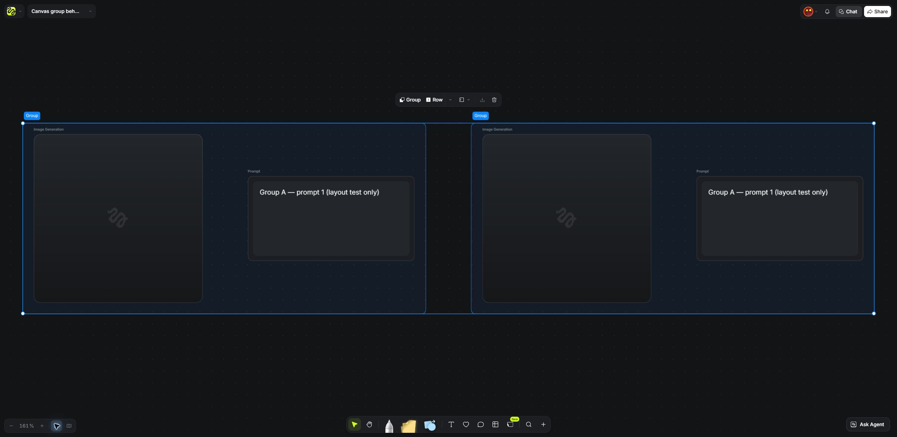
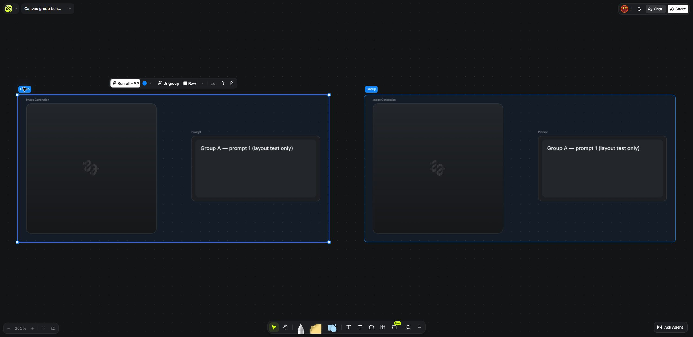
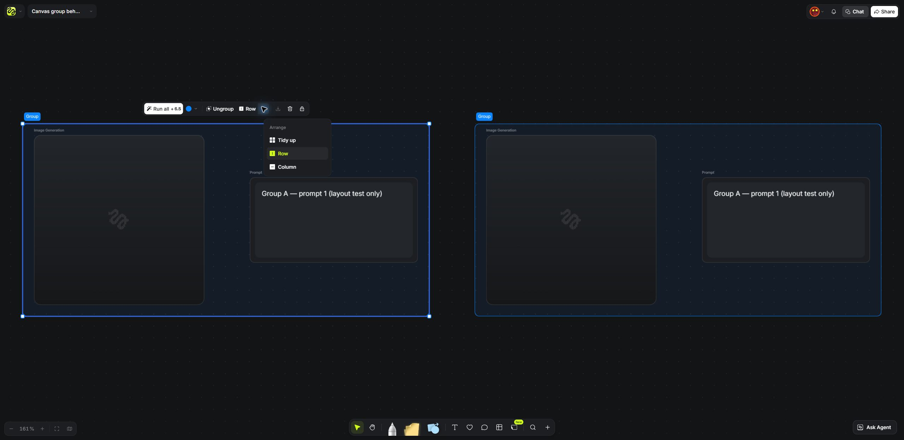
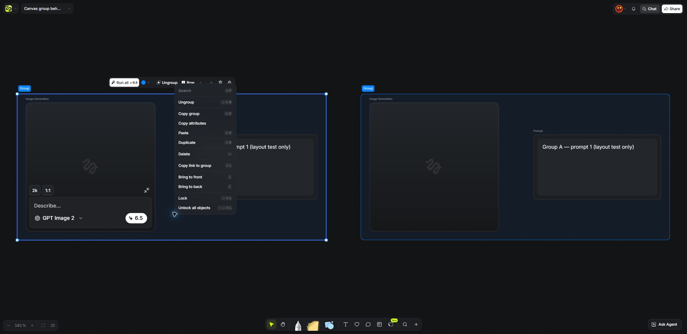
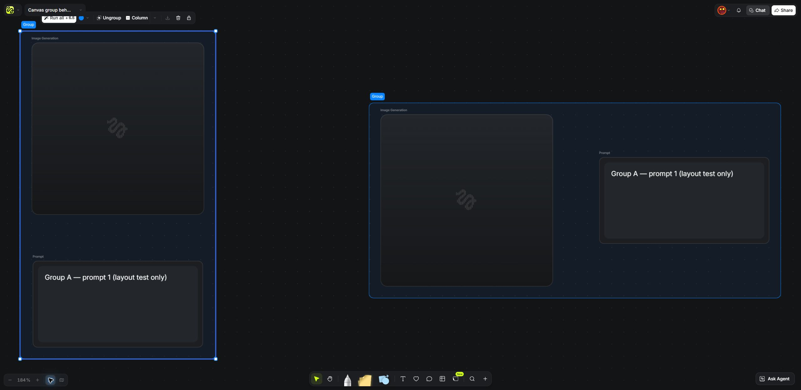

# Higgsfield：Canvas 分组与排列

- 采集日期：2026-10-20，北京时间（Asia/Shanghai）。
- 来源：用户已登录的 Chrome，Higgsfield 实际产品界面，English locale。
- 产品入口：[Canvas](https://higgsfield.ai/canvas-intro)；[官方使用说明](https://higgsfield.ai/creator-hub/help-center/tools/how-do-i-use-canvas)。
- 实测画布：`Canvas group behavior test · 2026-10-20`。账号专属地址不收录到版本化引用资源。
- 内容：一个 Prompt 和一个未运行的 Image Generator 成组，再复制为第二组。未上传素材，未点击 Run / Run all。
- 原始截图均为 2560 × 1249 JPEG；文件与哈希见 [capture-index.json](capture-index.json)。

## 截图索引

| 文件 | 状态与操作 | 可核实内容 |
|---|---|---|
| [01-two-groups-row.jpg](01-two-groups-row.jpg) | 选中两个组，执行 Row | 两组可同时完整显示，并排留出间距；多选工具栏含 Group / Row |
| [02-group-actions.jpg](02-group-actions.jpg) | 只选择左侧组 | 组工具栏含 Run all、颜色、Ungroup、Row、排列选择、下载、删除、锁定 |
| [03-arrange-menu.jpg](03-arrange-menu.jpg) | 打开 Choose arrange option | Arrange 菜单提供 Tidy up / Row / Column，当前选择 Row |
| [04-group-context-menu.jpg](04-group-context-menu.jpg) | 右击左侧组 | Ungroup、Copy group、Duplicate、层级、锁定等组操作；节点的 Collapse prompt 是另一层控制 |
| [05-column-layout.jpg](05-column-layout.jpg) | 左组切换 Column，右组保留 Row | 左组节点竖排、容器随内容变化，右组仍完整显示；可与横排图对照 |

## 可重复的操作

1. 从 Canvas 主菜单 Create new canvas 建独立测试画布。
2. Add node → Prompt，输入测试文字；Add node → Image Generator，仅创建空节点。
3. 选择这两个节点 → Group selected nodes。
4. Tidy up 可整理重叠的组内节点；Choose arrange option 可切换 Row / Column。
5. 组右键 → Duplicate，选中两组 → Row selected nodes；Return to content 适配视野。
6. 检查组工具栏与右键菜单；对照单节点 Collapse prompt，避免混淆控制层级。
7. 本次采集结束后，两组恢复横排；测试画布保留。

## 事实与边界

**已实际操作确认**：创建组、复制组、Tidy up、组内横/竖排、多组横排与多组同时可见。
容器完整包住显示内容；排列操作为节点/组分配间距。

**本次检查未发现**：组工具栏、排列菜单和组右键菜单中的整组 Collapse / Expand 入口。
这只是对所检查界面的观察，不能推导为所有版本、账号或快捷键都不支持整组折叠。

**不属于这次确认的能力**：展开时自动推开其他组、默认只展开一个组、单组下钻视图。
若 BeatDesign 采用这些交互，应作为我们的设计明确说明。

## 原始截图

### 多组横排

### 组操作

### 排列菜单

### 组右键菜单

### 竖排与横排对照

